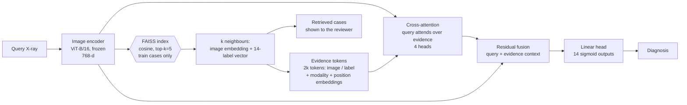

# CXR-Recall architecture

A retrieval-augmented chest X-ray classifier. Before it predicts, the model looks up the most similar past cases and reads their images and diagnoses as evidence. It returns a 14-label diagnosis plus the retrieved cases it relied on.

This document describes the final design and why each part is the way it is. Every design decision below was made by building the alternative, measuring it, and keeping whichever won. The experiment logs behind each decision are in [RESULTS.md](RESULTS.md).

## 1. System overview

The model has three stages:

1. **Encode.** A ViT-B/16 image encoder turns the X-ray into a 768-d embedding. It's trained once as a plain classifier (the baseline), then frozen.
2. **Retrieve.** The embedding searches a FAISS index of the training cases (exact cosine, top 5). During training, a query's own study is excluded from its neighbours.
3. **Fuse and classify.** Each neighbour becomes two tokens, one for its image and one for its labels. The query attends over those tokens, the resulting evidence context is added to the query embedding, and a linear head predicts 14 findings.

| Component | Code | Trainable |
|---|---|---|
| Image encoder (ViT-B/16, 768-d) | `src/models/encoders.py:ImageEncoder` | No (frozen copy of the baseline's encoder) |
| Retrieval index (FAISS `IndexFlatIP`) | `src/retrieval/faiss_index.py` | No |
| Leakage-safe search | `faiss_index.py:search_excluding_study` | No |
| Evidence encoder (joint attention) | `src/models/evidence_encoder.py:EvidenceEncoder` | Yes |
| Fusion classifier | `src/models/fusion_classifier.py:RetrievalFusionClassifier` | Head + evidence encoder only |
| Retrieval-quality metrics | `src/retrieval/metrics.py` | — |

**Dataset:** Indiana University chest X-rays (Open-I): 7,466 images from 3,851 studies, split 5,977 / 746 / 743 at the study level (seed 42). The labels are the 14 most frequent MeSH `Problems` tags.

## 2. Data flow

**Training**
1. Train the baseline classifier (encoder + linear head) and keep the best checkpoint by val AUROC.
2. Embed every training image with that encoder and build the FAISS index.
3. Retrieve 5 neighbours for every training image, excluding its own study.
4. Build the fusion classifier, load the baseline encoder's weights and freeze them, then train only the evidence encoder and head.

**Inference**
1. Embed the query image.
2. Retrieve its 5 nearest training cases. Val/test studies never appear in the index, so no exclusion is needed.
3. Fuse and classify, then return the diagnosis together with the retrieved cases.

## 3. Design decisions

Each record gives the problem, what was chosen, what else was tried, and the evidence. Numbers marked *val* come from runs before the September 2026 audit, which selected and reported on the validation set. Numbers marked *test* come from held-out evaluation after the audit.

### D1. Neighbours carry their images, not just their labels

- **Problem:** the first design represented each neighbour only by its 14-label vector. Only ~30% of retrieved neighbours share a label with the query (label agreement@5 ≈ 0.30), and a label vector gives the model no way to tell a close visual match from a poor one.
- **Tried:** label-only evidence. It was causally used (removing it shifted predictions by 0.052) but **hurt** accuracy: 0.7025 vs the baseline's 0.7335 (*val*).
- **Chosen:** each neighbour also contributes its image embedding, through its own learned projection (`image_proj`), so retrieval space and fusion space aren't forced to be the same.
- **Evidence:** adding image embeddings (early-fusion version) reached 0.7278 *val*, closing ~82% of the gap. Image embeddings accounted for ~81% of the model's reliance on evidence.

### D2. Joint attention over separate image and label tokens

- **Problem:** early fusion blended each neighbour's image and labels into one vector *before* attention, so the model couldn't trust a neighbour's image while ignoring its labels.
- **Chosen:** each neighbour becomes two tokens (2k = 10 in total). Each token gets a learned modality embedding (image or label) and a learned neighbour-position embedding (which tokens belong to the same case). The query attends over all of them.
- **Evidence:** 0.7318 *val*, closing 94.5% of the gap. With the freedom to separate them, the model put **~98% of its evidence reliance on images**, discounting the unreliable labels without being told to. That pattern has now replicated in every run (5 of 5, 95–99%).

### D3. Freeze and share the baseline's encoder

- **Problem:** with its own trainable encoder, the fusion model differed from the baseline in two ways at once (fusion *and* encoder training), so any gap couldn't be attributed to fusion.
- **Chosen:** `load_and_freeze_encoder()` loads the baseline's exact encoder weights and freezes them, and the encoder stays in eval mode even during training. The only thing that differs from the baseline is the evidence pathway.
- **Evidence:** the frozen variant was the first to beat the baseline in a single run (0.7360 vs 0.7192 *val*). The choice stands because it makes the comparison fair, but the 3-seed test comparison (section 4) shows the gain itself does not hold.

### D4. Residual fusion

- **Chosen:** `fused = query + evidence_context`. If the evidence is useless, the model can learn to make the context small and fall back to the image alone, so evidence can't easily make things worse than the baseline.

### D5. Leakage-safe retrieval

- **Problem:** most studies have 2–3 views sharing one report and label vector. Excluding only the query image still let its study-mate be retrieved, which hands the model the query's own labels.
- **Chosen:** `search_excluding_study` drops all same-study neighbours during training. Every run prints a `LEAKAGE CHECK` rate.
- **Evidence:** the measured rate was small (0.9–1.2% of training queries), so earlier results stand, but the guard stays in.

### D6. Report text is not an input to the diagnosis

- **Problem:** Open-I's labels are derived from the report text, so a model that reads the report can read its answer.
- **Tried:**
  1. Naive joint image+text training reached 0.9958 AUROC, but the image branch collapsed to 0.5328, below the image-only baseline (*val*). The model was reading label words out of the reports.
  2. A redesign with separate image and text towers, aligned by CLIP-style contrastive pretraining and then frozen (`src/models/contrastive.py`), fixed the collapse (image probe 0.6944 *test*). But text alone still scored 0.9355 *test*, and adding the image changed nothing.
  3. Using only the Findings section still recovers the labels at 0.9767 *test* (word-level check).
- **Decision:** the production path is image-only. On this dataset, whether text genuinely helps can't be measured, because every text input contains the label source. The dual-tower components are kept in the repo as a documented investigation.

### D7. No evaluation-time confidence gate

- **Tried:** switching off evidence for queries whose top neighbour similarity falls below a threshold fitted on train (`src/retrieval/confidence.py`).
- **Evidence:** the threshold flagged ~67% of queries, and gated accuracy fell to 0.6797 *test*, below the baseline. The head had only ever been trained with evidence present, so a zeroed context was an input it had never seen.
- **Decision:** rejected in this form. Similarity *is* a real relevance signal (label agreement rises 0.21 → 0.43 across val similarity quintiles), so gating during training remains a valid future design.

### D8. Retrieval uses the whole embedding

- **Tried:** query-adaptive selection of embedding dimensions (`src/retrieval/feature_weighting.py`), in soft-weighted, hard-selected and shortlist re-rank variants.
- **Evidence:** no gain (−0.0035 *test*, p=0.44). Even choosing dimensions from the query's true labels gained at most +0.003, because the embedding doesn't keep different findings in different dimensions.
- **Decision:** keep plain cosine. A retrieval gain would need a better representation, such as region-level features.

### D9. Swap the encoder for RAD-DINO; better retrieval still doesn't help the diagnosis

- **Problem:** retrieval is weak. Only ~30% of retrieved neighbours share a finding with the query, and for abnormal queries P@5 is ~0.19 against a ceiling of 1.0. The current encoder is an ImageNet ViT fine-tuned on ~6,000 Open-I images.
- **Tried:** retrieval with 8 embeddings, all on the same train gallery and 743 test queries (`notebooks/cxr_recall_retrieval_encoder_comparison_kaggle.ipynb`): the ImageNet ViT before fine-tuning, the fine-tuned baseline ViT (current), TorchXRayVision DenseNet-121 trained on CheXpert, and RAD-DINO (a ViT-B/14 self-supervised on ~880k chest X-rays from MIMIC-CXR, CheXpert, NIH, PadChest and BRAX; none of them Open-I). Each with its CLS token and the mean of its patch tokens. P@5 is measured separately for abnormal queries, because "normal" matches are easy and the 19% of queries with no top-14 tag can never match.
- **Evidence (test P@5, abnormal queries; random 0.131, ceiling 1.0):**

  | Encoder | Abnormal P@5 | Tagged P@5 | MRR | Paired vs current, abnormal |
  |---|---|---|---|---|
  | ImageNet ViT, not fine-tuned | 0.166 | 0.333 | 0.395 | −0.029 [−0.056, −0.001] |
  | **Current: fine-tuned ViT, CLS** | **0.194** | **0.363** | 0.385 | — |
  | Fine-tuned ViT, patch mean | 0.206 | 0.361 | 0.383 | +0.012 [−0.012, +0.036] |
  | TorchXRayVision DenseNet (CheXpert) | 0.173 | 0.316 | 0.379 | −0.021 [−0.050, +0.006] |
  | **RAD-DINO, CLS** | **0.273** | **0.398** | **0.444** | **+0.078 [+0.046, +0.111], p = 2×10⁻⁶** |
  | RAD-DINO, patch mean | 0.184 | 0.353 | 0.408 | −0.010 [−0.039, +0.019] |

  RAD-DINO CLS was also best on val (abnormal 0.254 vs 0.234), so the test result is not a selection effect. Its abnormal-query gain stays significant after correcting for all 12 comparisons. Used as-is, with no training on Open-I, it improves abnormal-case retrieval by ~40% over the current fine-tuned encoder.
- **Two side findings:** (1) a domain-specific encoder is not enough by itself: the CheXpert DenseNet is the worst of the chest-X-ray encoders, and its supervised labels don't match Open-I's tags. (2) RAD-DINO's similarities are spread out (median top-1 cosine 0.53) while the current encoder's are compressed (0.99), so RAD-DINO's similarity scores would be far more meaningful to show a reviewer.
- **Follow-up: does better retrieval improve the diagnosis?** (`notebooks/cxr_recall_d9_raddino_retrieval_kaggle.ipynb`, 5 training seeds.) The D3 design was rebuilt with frozen RAD-DINO as the shared encoder, so every arm sees the same query features. Three arms: `probe` (linear head, no retrieval), `retrieval` (top-5 RAD-DINO neighbours, joint attention, residual fusion) and a new `random_control` (same architecture, 5 random training cases). The control separates a retrieval effect from the effect of the extra parameters. Each arm swept the learning rate on val; no selected run hit the epoch cap.

  | Test macro AUROC, 5 seeds | Mean ± std |
  |---|---|
  | `probe` (RAD-DINO, no retrieval) | 0.7461 ± 0.0038 |
  | `retrieval` (CXR-Recall on RAD-DINO) | 0.7526 ± 0.0062 |
  | `random_control` | 0.7505 ± 0.0121 |
  | Retrieval − probe | +0.0065, 95% CI [−0.001, +0.014], p = 0.075, positive 4/5 |
  | **Retrieval − random neighbours** | **+0.0021, 95% CI [−0.006, +0.010], p = 0.49, positive 3/5** |
  | Random − probe | +0.0044, 95% CI [−0.010, +0.019], p = 0.45 |

  Retrieval leans slightly above the baseline, but not significantly, and it is **indistinguishable from random neighbours**. Whatever small gain there is comes from the evidence pathway's extra parameters, not from finding similar cases. Image share of evidence reliance: 96% (95–97%), now replicated with a second encoder.
- **The bigger finding is the encoder itself.** A linear head on frozen RAD-DINO features (0.7461 ± 0.0038) beats the fine-tuned ViT baseline (0.7131 ± 0.0100, section 4) by +0.033 test AUROC (Welch t-test p = 0.02; different runs, so not paired). It is also less sensitive to the seed (std 0.004 vs 0.010), and it needs no image-level training.
- **Decision:** adopt frozen RAD-DINO as the encoder. Keep retrieval for showing the reviewer similar cases, not for accuracy: on this dataset it doesn't hurt (−0.006 to +0.013 per seed) but its benefit can't be told apart from random evidence. Two side observations: the evidence models peak at epoch 2–3 against the probe's 5–78, so the attention pathway overfits almost immediately on ~6,000 cases. With RAD-DINO, 5.4% of training queries would have retrieved their own study (1.2–1.6% with the ViT), so the D5 guard matters more with a better encoder.

## 4. Measured performance

**Final design (D9): frozen RAD-DINO encoder.** 5 seeds, same 743 test images: linear head 0.7461 ± 0.0038; with retrieval 0.7526 ± 0.0062 (not significantly different, and not distinguishable from random neighbours). The tables below are the original ViT-based design.

### Original design: ViT-B/16 encoder

All on the same 743 held-out test images. The split is fixed (seed 42). Each training seed retrains both the baseline and CXR-Recall, so the per-seed gains are paired.

| Test | Seed 0 | Seed 1 | Seed 2 | Mean ± std |
|---|---|---|---|---|
| Baseline classifier (no retrieval), macro AUROC | 0.7142 | 0.7026 | 0.7226 | 0.7131 ± 0.0100 |
| CXR-Recall (frozen encoder, joint attention), macro AUROC | 0.7167 | 0.6936 | 0.7166 | 0.7090 ± 0.0133 |
| **Paired gain over the baseline** | +0.0025 | −0.0090 | −0.0060 | **−0.0042 ± 0.0060** |
| Retrieval label agreement@5 (random ≈ 0.19) | 0.2886 | 0.3074 | 0.2913 | 0.2958 |
| Share of evidence reliance on neighbour images | 97.6% | 95.4% | 97.5% | ~97% |

**Gain:** 95% CI [−0.019, +0.011], paired t-test p = 0.35, positive in 1 of 3 seeds.

**What this means.** On this dataset, the retrieval pathway gives **no measurable gain** over the same frozen encoder used alone. The earlier single-run wins (D3, up to +0.026 *val*) were within the baseline's own run-to-run spread (~0.02), which is why the multi-seed run was required before claiming anything. The pathway's behaviour is stable: in every seed the model relied ~95–98% on neighbour images rather than their labels. The likely limit is retrieval itself: only ~30% of retrieved neighbours share a finding with the query, and D8's oracle shows the embedding can't be re-weighted into a better one. D9 tested the obvious fix: RAD-DINO improves abnormal-case retrieval by ~40%, yet retrieval still can't be told apart from random neighbours. What RAD-DINO does improve is the classifier itself (+0.033).

Seed 0 was run twice (the notebook re-ran it in the session that produced the aggregate). The first run gave baseline 0.7099, CXR-Recall 0.7123, gain +0.0024. Using it instead changes the mean gain by less than 0.0001 (p = 0.34). Both runs are in `results/phase1_multiseed_results.jsonl`.

## 5. Limitations

- **Small dataset:** about 6,000 training images, with thin labels (Diaphragm has 17 val positives), so per-label AUROCs are noisy.
- **Weak labels:** the labels are MeSH tags derived from reports, not radiologist-verified findings.
- **Coarse relevance proxy:** retrieval quality is measured by shared labels, which only approximates clinical similarity.
- **Run-to-run noise:** training isn't bit-for-bit reproducible on GPU (re-running seed 0 moved the baseline 0.7099 → 0.7142). All performance claims rest on 3 seeds.
- **No accuracy gain from retrieval:** see section 4. The design is a working, leakage-safe retrieval-augmented classifier, not a more accurate one on this data.
- **No external validation:** the model is tested on one hospital's data only.
- **Explanation not exposed:** the attention weights over neighbours are computed but not yet returned, so a reviewer can see *which* cases were retrieved but not *how much* each one counted.

## 6. Future work

- Fine-tune RAD-DINO (D9 used it frozen), then rerun the retrieval and random-neighbour comparison.
- Regularise the evidence pathway (dropout, fewer parameters, image-only tokens): it peaks at epoch 2–3 (D9).
- Return per-neighbour attention weights alongside the retrieved cases.
- Train-time confidence gating (D7).
- Image-only evidence tokens, dropping the label tokens that carry ~1–3% of reliance (D2).
- Region- or patch-level retrieval in place of one pooled embedding (D8).
- Validation on a second dataset with radiologist labels (e.g. MIMIC-CXR, which needs credentialed access).
